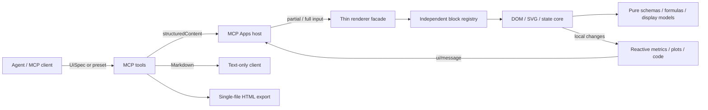

# Intelligence UI

[中文说明](README.zh-CN.md)

A declarative, streaming UI runtime and MCP Apps server for interactive interfaces inside AI conversations. Ship one HTML bundle to a compatible host, calculate locally, and return readable Markdown to text-only clients.


## Scope and alternatives

Intelligence UI is an independent implementation, not a client modification or a reproduction of a proprietary ChatGPT UI protocol. Agents supply data, formulas and a bounded component tree. The renderer owns markup, styling and interactions, using native DOM and SVG rather than generating executable frontend code. No React or other UI framework is required.

| Project | Integration model | Difference here |
| --- | --- | --- |
| [OpenUI](https://www.openui.com/docs) | A component library and OpenUI Lang rendered in an application's frontend; documentation includes a [React renderer](https://www.openui.com/docs/openui-lang/renderer). | A fixed UiSpec catalog delivered as a self-contained MCP Apps resource; no OpenUI Lang renderer is needed. |
| [A2UI](https://developers.googleblog.com/en/introducing-a2ui-an-open-project-for-agent-driven-interfaces/) | A declarative agent-to-UI format rendered through a client's trusted component catalog. | A bounded MCP Apps widget runtime with its own schema, local formulas and Markdown fallback, not an implementation of A2UI. |
| Intelligence UI | MCP tools return UiSpec JSON and Markdown; compatible hosts embed the bundled resource. | Compact calculators, comparisons, planning widgets and configuration previews, plus standalone HTML export. |

These are integration choices, not performance benchmarks or claims of protocol interchangeability.

## Architecture



Blocks never import each other. Containers receive `renderChild` and share reactive bindings. Architecture tests inspect the actual source import graph, including type imports and re-exports. The renderer is limited to 200 lines; each block to 220.

## Component catalog

There are **12 leaf blocks and 3 layout containers**, 15 kinds in total.

| Category | Kinds | Purpose |
| --- | --- | --- |
| Decisions and input | `choices`, `controls` | Decision cards; sliders, switches and segmented selectors defining shared variables. |
| Metrics and visualization | `stats`, `chart`, `plot`, `svg` | KPI cards; breakdown bars; line/bar/donut plots; safe vector diagrams. |
| Comparison and progress | `compare`, `checklist`, `timeline`, `architecture` | Matrices, checks, selectable steps and layered diagrams. |
| Explanation and configuration | `callout`, `code` | Semantic notes and interpolated, copyable configuration previews. |
| Layout | `grid`, `tabs`, `accordion` | Responsive composition and persistent tab/expansion state. |

Nesting is finite: a grid holds leaves; a tab or accordion item holds leaves or one grid. Containers cannot contain more tabs or accordions. Hidden panels stay mounted, allowing controls to drive other panels without losing state.

## Install and run from source

Requires Node.js 22 or newer and pnpm 10.15.1. Substitute your repository URL:

```sh
git clone <repository-url> intelligence-ui
cd intelligence-ui
pnpm install --frozen-lockfile
pnpm run check
pnpm dev
```

Playground: `http://127.0.0.1:3001/`. Streamable HTTP MCP: `http://127.0.0.1:3001/mcp`. Set the `PORT` environment variable before starting to use another port. `pnpm dev` runs the server from source but still needs a built UI bundle. Rebuild and refresh for UI changes; restart after changing presets or server code.

```sh
pnpm run typecheck
pnpm run build
pnpm test
```

`pnpm run check` runs typechecking, server compilation, Vite single-file bundling and tests. CI repeats frozen installation, build, tests and an export smoke check on Ubuntu with Node 22.

## Playground

Seven scenarios cover the catalog: `gpu-vram-tuner`, `runtime-compare`, `deploy-checklist`, `mcp-architecture`, `composable-workbench`, `svg-visual-lab`, `agent-launch-kit`.

- Replay partial input and watch completed blocks mount progressively.
- Toggle the host theme and Wide/Compact preview widths.
- Expand **Custom JSON Spec**, paste JSON, then run it fully or stream it by block. The server's Zod schema reports validation field paths.
- Inspect collapsible bridge activity. `ui/message` receives a JSON-RPC response and a temporary message preview.
- Clipboard writes are delegated to the local preview iframe. Production hosts may deny access; failures are shown explicitly.

Presets are editable demonstrations. Planning targets and memory estimates are not measured hardware benchmarks. The launch command contains a model placeholder and must be reviewed; this project never executes it.

## MCP integration

The server exposes `render_intelligence_ui` (custom UiSpec), `inspect_preset_ui` (a preset) and `ui://intelligence-ui/view.html`. Both tools detect the connected client's advertised UI capability. Native MCP Apps clients keep the original Markdown and `structuredContent` response without export hints or file writes, even if `embedPath` is supplied.

Without UI capability, names matching Antigravity, Jetski or Cascade select `antigravity` mode; other clients select `markdown`. `INTELLIGENCE_UI_HOST=antigravity` can override the non-UI branch, but never overrides advertised MCP Apps support. These modes are capability-based fallbacks, not guarantees that a client implements a particular embed tag.

In local `--stdio` mode, either tool accepts an optional `embedPath` pointing to a local `.html` artifact file. The server writes an embed-ready single file and returns its `file:///` URI, not the HTML source. Cross-directory artifact paths are allowed; device paths, reserved names, alternate streams and other extensions are rejected. HTTP never permits tool-triggered file writes. For example, call `inspect_preset_ui` with `{"preset":"agent-launch-kit","embedPath":"artifacts/launch-kit.html"}` from a local non-UI client. The client decides how to embed the resulting artifact. Existing regular HTML files at the requested path are overwritten.

The `render_intelligence_ui` description includes a complete controls/stats/svg example. The resource `intelligence-ui://examples/svg` provides editable capacity, flow and size diagrams. The wire schema retains all block variants without `$ref`; some clients may simplify complex union types in model-facing tool definitions, so consult the example instead of guessing fields.

For Claude Desktop or another stdio client, build first and configure:

```json
{
  "mcpServers": {
    "intelligence-ui": {
      "command": "node",
      "args": ["<repository>/dist/main.js", "--stdio"]
    }
  }
}
```

Replace `<repository>` with your checkout directory and restart the client. Do not use the HTTP entry command in a stdio configuration.

For an HTTP-capable MCP client, run `pnpm dev` or `node dist/main.js` and configure a Streamable HTTP URL of `http://127.0.0.1:3001/mcp`. This server binds to loopback; public hosting, authentication and TLS are outside its scope.

```sh
node dist/main.js --stdio
node dist/main.js --export agent-launch-kit out/launch-kit.html
node dist/main.js --export docs/example.json out/custom.html
node dist/main.js --export agent-launch-kit out/embed.html --embed
cat docs/example.json | node dist/main.js --export - out/from-stdin.html --embed
```

Export syntax: `--export <preset|spec.json|-> <output.html> [--embed]`. `-` reads and validates JSON from stdin; PowerShell users can pipe `Get-Content -Raw docs/example.json` instead of `cat`.

Open exported HTML directly: all scripts and styles are inline. Exported pages, including iframe embeds, never connect to MCP Apps or send host messages. Footer actions copy and code cards have a Copy button; browser clipboard permissions still apply and denials are visible. Page state stays local and is not written back to the source JSON.

`--embed` additionally enables a transparent background and compact spacing. Theme synchronization observes light/dark classes and accessible parent theme attributes, and accepts a `themechange` CustomEvent with `detail: "light"` / `"dark"` or `{theme: "light"}`. Cross-origin parent styles cannot be inspected: such hosts must set the embedded document's theme or deliver its theme event through their own integration. Without a signal, system light/dark preferences apply.

Rendering reports `ready`, `partial` or `error`, rendered top-level block count and pending block count through the document's `intelligence-ui:render` event and `data-iui-render-status`. Connected MCP Apps views also send reports through SDK logging, visible in Playground bridge activity; render exceptions identify the block position. A tool result alone proves server success, not client display. No render acknowledgment blocks the tool response, and text-only clients cannot confirm interactive rendering.

## Variables and formulas

Control IDs define variables. Numeric formulas support arithmetic, comparisons, booleans, ternaries and `min`, `max`, `abs`, `floor`, `ceil`, `round`, `clamp`, `if`. `+` concatenates if either operand is a string; otherwise it retains numeric addition. There is no JavaScript evaluation, property access or arbitrary function invocation.

The runnable [example spec](docs/example.json) combines controls, stats and a code preview. Code templates substitute `{{var}}` and leave unknown placeholders visible. SVG numeric attributes accept `*Formula`; `textFormula` supports expressions such as `round(vram, 1) + ' GB'`. Incomplete expressions use safe fallbacks. Code interpolation is text substitution, not shell escaping: review output before use.

`plot` supports `line`, `bar`, `donut`, labeled `points` with `value` or `formula`, `max`/`maxFormula`, `precision`, axis labels and a donut `centerFormula`. Vector drawings use positive `width`/`height`, an optional caption and an `elements` array whose entries identify a whitelisted `type`.

## Security and behavior boundaries

- Native DOM/SVG construction and `textContent` prevent specs from supplying executable markup.
- SVG allows `rect`, `circle`, `line`, `path`, `text`, `polyline`, `polygon`. Tags, attributes, point strings and semantic colors are validated; scripts, foreign objects, event attributes, external links and arbitrary paint URLs are rejected.
- Bounded schemas expand without recursive `$ref` graphs. Valid streamed vector, stats and timeline entries can mount while incomplete entries remain pending.
- The inline UI has no CDN, external images, UI font downloads or dynamic-code requirement. The host's sandbox and CSP control capabilities.
- Initial/changed host themes, style variables and local font faces synchronize through the SDK. Network font imports/faces are ignored; absent variables use the built-in Linear-style palette.
- Sliders and switches update bindings in place. `send_message` uses the host bridge; `copy_state` bypasses it. A denied copy shows an actionable status instead of false success.
- This is a fixed-catalog widget runtime, not an arbitrary HTML browser, shell executor, general dashboard framework or OpenUI/A2UI compatibility layer.

## Packaging and contributing

```sh
pnpm pack --pack-destination out
```

The prepack check builds and tests first. The allowlist ships the compiled server, inline UI bundle, raw Playground HTML, docs and license. Playground is read from disk, so it must ship alongside the compiled bundle; it is not a Vite entrypoint.

To add a block, define a finite schema, independent renderer and Markdown fallback, register it and update the architecture allowlist. Test real contracts and important failure boundaries, not preset-specific numbers, Markdown punctuation or test helpers. See [AGENTS.md](AGENTS.md).

## License

[MIT](LICENSE). Third-party dependencies retain their respective licenses.
