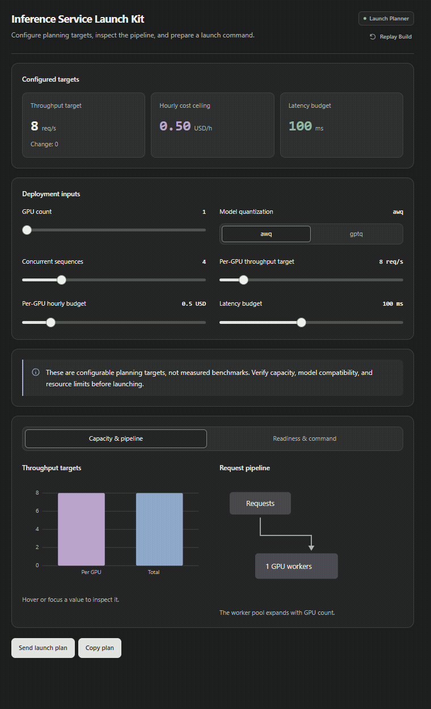
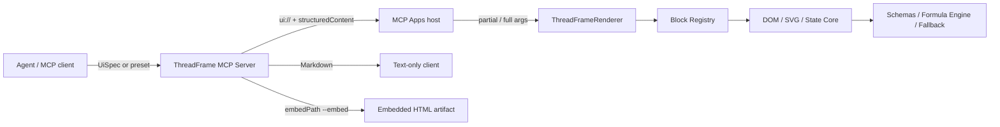

# ThreadFrame

[](https://github.com/losewayy/threadframe/actions/workflows/ci.yml)
[](LICENSE)
[](package.json)

[中文说明](README.zh-CN.md)

**ThreadFrame** is an open-source streaming UI runtime and MCP Apps server (`ui://`, SEP-1865) that renders interactive cards directly inside AI chat threads. Agents emit compact declarative JSON; ThreadFrame streams blocks progressively, computes formulas locally without `eval`, draws reactive vector graphics, and adapts automatically to each host client.



## Quick Start

Requires **Node.js 22+** and **pnpm 10.15.1**.

### 1. Preview locally in the Playground

```sh
git clone https://github.com/losewayy/threadframe.git
cd threadframe
pnpm install --frozen-lockfile
pnpm start
```

Open `http://127.0.0.1:3001/` to explore all 7 built-in presets, simulate token-by-token partial streaming, toggle light/dark themes, switch Wide/Compact preview widths, and test your own JSON specs.

### 2. Connect to Codex

```sh
codex mcp add threadframe -- node /path/to/threadframe/dist/main.js --stdio
```

### 3. Connect to Claude Desktop or any stdio MCP client

```json
{
  "mcpServers": {
    "threadframe": {
      "command": "node",
      "args": ["/path/to/threadframe/dist/main.js", "--stdio"]
    }
  }
}
```

> Streamable HTTP is also available at `http://127.0.0.1:3001/mcp` when running `pnpm start` or `pnpm dev` (loopback only).

### 4. Export a standalone or embeddable HTML file

```sh
node dist/main.js --export agent-launch-kit out/launch-kit.html
node dist/main.js --export docs/example.json out/custom.html --embed
cat docs/example.json | node dist/main.js --export - out/from-stdin.html --embed
```

All scripts and styles are bundled into one zero-dependency HTML file (`dist/mcp-app.html`).

## One MCP Server, Adaptive Per Client

ThreadFrame inspects each client's advertised MCP capabilities during handshake (`getUiCapability` and `clientInfo`) and routes responses automatically:

- **MCP Apps hosts** (such as Codex or MCP Apps desktop clients): keeps standard `ui://threadframe/view.html` metadata and `structuredContent` so interactive cards mount natively in chat.
- **Embedded HTML hosts** (such as Antigravity, or when `THREADFRAME_HOST=antigravity` is set on non-UI hosts): supports passing `embedPath` in local `--stdio` mode to write a compact, transparent `--embed` HTML artifact directly to disk without bloating model context.
- **Terminal / text-only clients**: returns clean structured Markdown tables, bullet summaries, and interpolated code fences automatically.

## Component Catalog (17 Kinds)

There are **14 leaf blocks** and **3 layout containers**:

| Category | Kinds | Purpose |
| --- | --- | --- |
| Decisions & inputs | `choices`, `controls` | Decision cards (`setVars` or immediate prompts); sliders, toggles, and segmented selectors. |
| Metrics & charts | `stats`, `chart`, `plot`, `svg` | KPI cards; breakdown bars; `line`, `bar`, and `donut` plots plus parameterized function curves with undefined-point breaks; reactive whitelisted vector canvases. |
| Comparison & flow | `compare`, `checklist`, `timeline`, `architecture` | Comparison matrices, stateful checklists, selectable step timelines, and interactive layered diagrams. |
| Topology & data | `graph`, `table` | Auto-laid node/edge graphs with no manual coordinates; sortable, filterable engineering tables with derived cells. |
| Notes & config | `callout`, `code` | Semantic callouts and `{{var}}`-interpolated, copyable command/config snippets. |
| Layout containers | `grid`, `tabs`, `accordion` | Responsive multi-column grids, persistent tabs, and collapsible sections sharing live variable bindings. |

Nesting is intentionally bounded: `grid` holds leaves; `tabs` and `accordion` items hold leaves or one `grid`. Hidden tabs and collapsed accordions stay mounted so controls and charts across panels stay synchronized.

Built-in presets (`inspect_preset_frame`): `gpu-vram-tuner`, `runtime-compare`, `deploy-checklist`, `mcp-architecture`, `composable-workbench`, `svg-visual-lab`, `agent-launch-kit`.

## How It Works



- **MCP Tools**: `render_threadframe` (renders any custom `UiSpec`), `inspect_preset_frame` (renders a showcase preset), and the compact shortcuts `present_calculator`, `present_decision`, and `present_diagram`. Shortcuts expand into a standard UiSpec through a pure compiler, so Zod validation, rendering, `--embed`, and Markdown fallback stay single-sourced.
- **MCP Resources**: `ui://threadframe/view.html` (the single-file runtime bundle), `threadframe://examples/svg` (three editable SVG + control recipes), and `threadframe://examples/recipes` (minimal shortcut inputs).
- **Formulas & Templates**: Controls bind variables into an arithmetic/comparison/ternary recursive-descent parser (`min`, `max`, `abs`, `floor`, `ceil`, `round`, `clamp`, `if`, plus string `+` concatenation). Curve plots sample formulas over a domain and break at undefined points. Code blocks substitute `{{var}}` safely via `textContent`. See [docs/example.json](docs/example.json).
- **Snapshot Loop (opt-in)**: When a local `--stdio` shortcut call provides an explicit `statePath`, the Apply & remember action writes a compact JSON snapshot; `read_threadframe_state` returns it on the next turn. Without `statePath`, nothing touches disk.

## Security Boundaries

- **Zero `eval` / `new Function`**: All expressions run through a dedicated tokenizer and recursive-descent parser safe under strict CSP sandboxes.
- **Native DOM & SVG Whitelist**: Elements are built with `createElement` / `createElementNS` and `textContent`. SVG only allows `rect`, `circle`, `line`, `path`, `text`, `polyline`, and `polygon` with validated coordinates and semantic theme tokens; `<script>`, `<foreignObject>`, inline event handlers, and external URLs are rejected by schema.
- **Bounded Non-Recursive Schema**: Tool JSON Schemas expand without `$ref` recursion so strict validators accept every block kind cleanly.
- **Scoped File Writes**: `embedPath` and snapshot `statePath` are only accepted in local `--stdio` mode (blocked over HTTP) for `.html` / `.json` paths, with device names, ADS streams, UNC paths, trailing dots, and symlink components rejected.
- **Render Telemetry & Clipboard Fallback**: Views emit `threadframe:render` (`ready`, `partial`, `error`) and `data-iui-render-status`. Copy actions fall back cleanly from `navigator.clipboard` to a synchronous `<textarea>` copy inside sandboxed iframes.

## Development

```sh
pnpm run typecheck   # TypeScript check
pnpm run build       # Compile server + single-file dist/mcp-app.html
pnpm test            # Architecture DAG, schema, formula, fallback & MCP protocol tests
pnpm run check       # Full build + test gate
```

Repository rules and test standards live in [AGENTS.md](AGENTS.md). Architecture tests enforce a strict acyclic dependency graph across `src/`, keeping `src/runtime/renderer.ts` under 200 lines and each block under 220 lines.

## License

[MIT](LICENSE)
