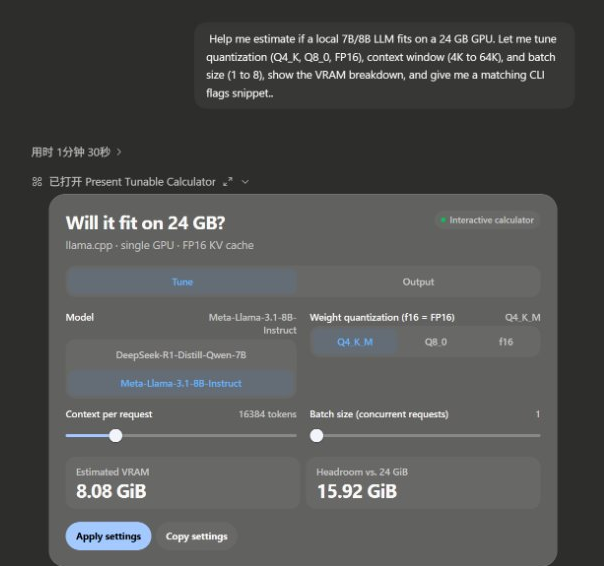
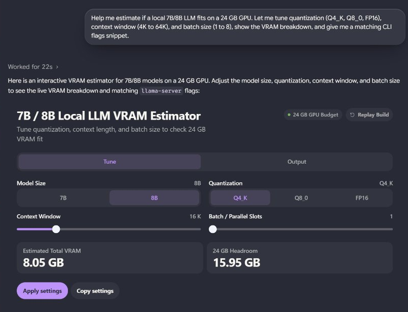
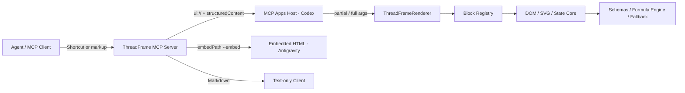

<div align="center">

# ThreadFrame

**Streaming interactive cards for AI chats over a single adaptive MCP server (`ui://`, SEP-1865)**

[](https://github.com/losewayy/threadframe/actions/workflows/ci.yml)
[](LICENSE)
[](package.json)
[](docs/agent-prompts.md)

**English** · [简体中文](README.zh-CN.md)

</div>

ThreadFrame turns static LLM replies into compact, live-calculating interactive cards—sliders, toggles, decision matrices, auto-laid topology graphs, plotted curves, filterable tables, and pastel flow cards—from either 3 scenario shortcuts or concise JSX-like tags (`render_markup`). One server adapts automatically across native MCP Apps hosts, `<agent-embed>` HTML hosts, and terminal Markdown clients.

---

## Real Conversations, Side by Side

Same prompt (`"Help me estimate if a local 7B/8B LLM fits on a 24 GB GPU..."`), zero hand-written HTML, adapted automatically to each host:

<table>
  <tr>
    <th width="50%">Codex Desktop · Native MCP Apps (<code>ui://</code>)</th>
    <th width="50%">Antigravity · Embedded HTML (<code>&lt;agent-embed&gt;</code>)</th>
  </tr>
  <tr>
    <td></td>
    <td></td>
  </tr>
</table>

### Live Streaming & Markup Playground


---

## Why ThreadFrame

- **Focused 4-tool surface**: Exposes only non-overlapping entry points—`present_calculator`, `present_decision`, `present_diagram`, and `render_markup`—plus on-demand `read_threadframe_state`. Background snapshot writes (`save_threadframe_state`) are scoped with `visibility: ["app"]` so they stay hidden from the model prompt.
- **Tiny Schema, fast prompting**: `render_markup` takes a compact tag string (`<box>`, `<slider>`, `<plot>`, `<graph>`, `<table>`) with no `$ref` recursion, inline `{formula}` expressions, and line/column diagnostics on mistakes.
- **Progressive streaming**: Renders closed blocks while arguments stream in, showing a shimmer skeleton only for unfinished trailing blocks while preserving slider values and tab selections across updates.
- **Built-in proactive guidance**: Sends server-level MCP `instructions` during `initialize` alongside clear `Use when / Do not call for` rules and ready-to-copy client rules in [docs/agent-prompts.md](docs/agent-prompts.md).
- **Zero-dependency single-file UI**: All scripts and styles compile into `dist/mcp-app.html` (`~391 kB`) with no external network requests, `eval`, or `innerHTML`.

---

## Quick Start

Requires **Node.js 22+** and **pnpm 10.15.1**.

### 1. Build & explore in the Playground (30 seconds)

```sh
git clone https://github.com/losewayy/threadframe.git
cd threadframe
pnpm install --frozen-lockfile
pnpm start
```

Open `http://127.0.0.1:3001/` to test all 7 built-in scenarios, replay block-by-block streaming, switch dark/light themes and `760px` / `420px` widths, and live-compile `render_markup` tags or JSON specs.

### 2. Connect to Codex

```sh
codex mcp add threadframe -- node /path/to/threadframe/dist/main.js --stdio
```

### 3. Connect to Claude Desktop, Antigravity, or any stdio MCP client

```json
{
  "mcpServers": {
    "threadframe": {
      "command": "node",
      "args": ["/path/to/threadframe/dist/main.js", "--stdio"]
    }
  }
}
```

- Copy-ready proactive trigger snippets for Codex (`AGENTS.md`), Claude (`CLAUDE.md`), Cursor (`.cursor/rules`), and Antigravity (`<agent-embed>`) live in [docs/agent-prompts.md](docs/agent-prompts.md).
- Loopback Streamable HTTP MCP is also served at `http://127.0.0.1:3001/mcp` during `pnpm start` or `pnpm dev`.

### 4. Export standalone or embeddable HTML

```sh
node dist/main.js --export agent-launch-kit out/launch-kit.html
node dist/main.js --export docs/example.json out/custom.html --embed
cat docs/example.json | node dist/main.js --export - out/from-stdin.html --embed
```

---

## Focused MCP Tools

| Tool | When agents pick it | Output highlights |
| --- | --- | --- |
| `present_calculator` | Tunable parameters, sizing, memory, cost, or config flags | Sliders, toggles, segmented selects, live metrics/bars, copyable CLI template |
| `present_decision` | Choosing between 2–4 concrete options with trade-offs | Winner-highlighted comparison matrix, option cards, checklist |
| `present_diagram` | Layered call chains, pipelines, or dependency topologies | Cycle-safe auto-layout (`graph`), node groups, icon badges, reactive edge highlight |
| `render_markup` | Custom layouts, function curves, sortable/filterable tables, tinted flow cards | JSX-like tags compiling directly to `UiSpec` with line/column diagnostics |
| `read_threadframe_state` | Follow-up turn after a local `--stdio` MCP Apps `statePath` save | Reads confirmed JSON snapshot (disabled over HTTP) |

> `save_threadframe_state` is registered with `_meta.ui.visibility: ["app"]` so only UI actions invoke it over local `--stdio`.

---

## Compose Cards with `render_markup`

Use the three shortcut tools for standard calculators, decisions, and diagrams. Use `render_markup` whenever you want a custom layout:

```jsx
<frame title="Transfer capacity">
  <slider id="workers" label="Workers" min={1} max={8} default={3}/>
  <box tint="accent" padding="md">
    <title>Estimated throughput</title>
    <text>**{workers * 4} jobs/s** at full utilization</text>
  </box>
</frame>
```

- Quote strings; put numbers, booleans, and formulas in braces (`{expression}` in `<text>`, `<title>`, `<caption>`, and `<badge>` updates live from control IDs).
- Use `<plot><curve/></plot>` for parameterized curves (with automatic breaks on undefined values), `<graph><node/><edge/></graph>` for topologies, and `<table><column/><row><cell/></row></table>` for sortable/filterable data.
- Target roughly `450px` in chat (`1–3` inputs, `1` main visual, `1–3` results) and keep longer explanations in the surrounding reply. Read `threadframe://examples/markup` for copyable recipes.

---

## Component Catalog

| Category | Kinds | Purpose |
| --- | --- | --- |
| Decisions & inputs | `choices`, `controls` | Decision cards (`setVars` or prompt actions); sliders, toggles, segmented selectors |
| Metrics & charts | `stats`, `chart`, `plot`, `svg` | KPI cards, breakdown bars, line/bar/donut plots, parameterized curves, whitelisted reactive SVG |
| Comparison & flow | `compare`, `checklist`, `timeline`, `architecture` | Comparison matrices, checklists, step timelines, clickable layered architectures |
| Topology & data | `graph`, `table` | Auto-laid node/edge graphs with no manual coordinates; sortable/filterable tables with formula cells |
| Notes & config | `callout`, `code` | Semantic callouts and `{{var}}`-interpolated copyable command/config snippets |
| Layout primitives | `box`, `text`, `title`, `caption`, `badge`, `divider`, `icon` | Row/column layout, semantic tints, live inline formatting, 23 built-in SVG icons |
| Layout containers | `grid`, `tabs`, `accordion` | Responsive grids, persistent tabs, and collapsible sections sharing live bindings |

Top-level `box` and `grid` containers accept ordinary blocks plus one nested shallow `box` (`text`, `title`, `caption`, `badge`, `divider`, `icon`). Tool JSON Schemas expand statically with zero `$ref` recursion.

Built-in presets for the Playground and CLI `--export`: `gpu-vram-tuner`, `runtime-compare`, `deploy-checklist`, `mcp-architecture`, `composable-workbench`, `svg-visual-lab`, `agent-launch-kit`.

---

## How It Works



ThreadFrame inspects client capabilities (`getUiCapability` and `clientInfo`) on handshake and routes every tool response through one shared pipeline:

- **MCP Apps hosts** (such as Codex Desktop): receives `ui://threadframe/view.html` metadata and `structuredContent` for native inline mounting, and handles bi-directional `ui/message` actions directly back into the chat.
- **Embedded HTML hosts** (such as Antigravity, or `THREADFRAME_HOST=antigravity`): writes a compact, transparent `--embed` HTML artifact to `embedPath` over local `--stdio`.
- **Terminal / text-only clients**: receives clean Markdown tables, bullet summaries, and evaluated code snippets automatically.

---

## Security Boundaries

- **Zero `eval` / `new Function`**: Formulas execute in a dedicated recursive-descent parser (`min`, `max`, `abs`, `floor`, `ceil`, `round`, `clamp`, `if`, comparisons, ternary, string `+`), compatible with strict CSP sandboxes.
- **Native DOM & SVG allowlist**: Built strictly with `createElement` / `createElementNS` and `textContent`. `<script>`, inline event handlers, arbitrary `<style>`, and external URLs are rejected at schema validation.
- **Bounded non-recursive schemas**: Every MCP tool schema is finite and `$ref`-free.
- **Scoped local file writes**: `embedPath` (`.html`) and `statePath` (`.json`) are restricted to local `--stdio` (blocked over HTTP) and guard against device names, ADS streams, UNC paths, trailing dots, and symlink escapes.
- **Clipboard fallback**: Copy buttons fall back cleanly from `navigator.clipboard` to a synchronous `<textarea>` copy inside sandboxed frames.

---

## Development

```sh
pnpm run typecheck   # TypeScript typecheck
pnpm run build       # Compile server + single-file dist/mcp-app.html
pnpm test            # Architecture DAG, schema, formula, fallback & MCP protocol tests
pnpm run check       # Full build + test gate
```

Repository testing standards live in [AGENTS.md](AGENTS.md). Architecture tests enforce an acyclic dependency graph across `src/`, keeping `src/runtime/renderer.ts` under 200 lines and every block under 220 lines.

## License

[MIT](LICENSE)
