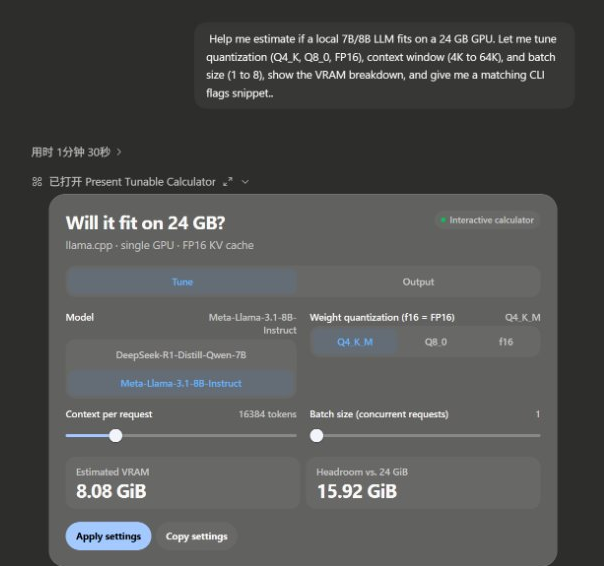
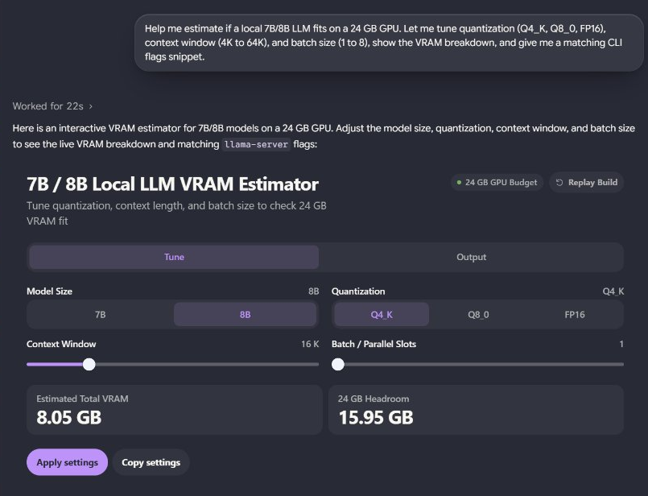
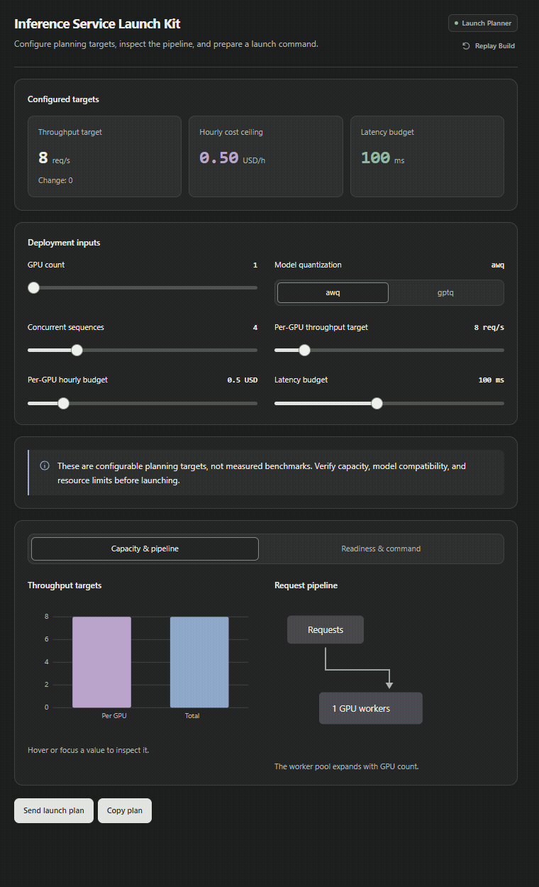
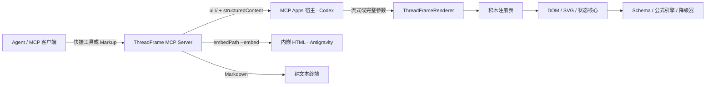

<div align="center">

# ThreadFrame

**为 AI 对话打造的流式可交互卡片运行时与自适应 MCP 服务（`ui://`，SEP-1865）**

[](https://github.com/losewayy/threadframe/actions/workflows/ci.yml)
[](LICENSE)
[](package.json)
[](docs/agent-prompts.md)

[English](README.md) · **简体中文**

</div>

ThreadFrame 可以把大模型的静态长文字，变成直接嵌在聊天气泡里的交互式小卡片——滑块试算、多方案对比矩阵、自动排版拓扑图、联动函数曲线、可排序筛选表格和柔色流程卡。模型既可以调用 3 个场景快捷工具，也可以用精简的 JSX 风格短标签（`render_markup`）自由拼装；同一套 MCP 服务会自动适配原生 MCP Apps 宿主、`<agent-embed>` 内嵌宿主和纯文本终端。

---

## 真实对话效果对比（同一句提问，双宿主实拍）

把完全相同的英文提问（`"Help me estimate if a local 7B/8B LLM fits on a 24 GB GPU..."`）直接发给两个客户端，两边均主动命中 `present_calculator`，并自动适应各自宿主的主题与通信协议：

<table>
  <tr>
    <th width="50%">Codex 桌面端 · 原生 MCP Apps（<code>ui://</code>）</th>
    <th width="50%">Antigravity · 内嵌单文件 HTML（<code>&lt;agent-embed&gt;</code>）</th>
  </tr>
  <tr>
    <td></td>
    <td></td>
  </tr>
</table>

### 流式构建与 Markup 实时调试台



---

## 核心特性

- **聚焦的 4 工具接口**：对外只保留互不重叠的 4 个写卡入口——`present_calculator`、`present_decision`、`present_diagram`、`render_markup`——外加按需读取的 `read_threadframe_state`；`save_threadframe_state` 标记了 `visibility: ["app"]`，仅允许卡片按钮回调，不给模型增加心智负担。
- **超短标签与极简 Schema**：`render_markup` 使用类 JSX 标签（`<box>`、`<slider>`、`<plot>`、`<graph>`、`<table>`），入参无 `$ref` 递归，文本支持 `{公式}` 实时联动，语法写错直接指出行列和字段。
- **渐进流式与状态保留**：参数流式到达时先把已经闭合的积木画出来，尾部未完成区域显示骨架屏占位，刷新时保留已调好的滑块值和当前标签页。
- **内置主动触发引导**：服务端在 MCP `initialize` 握手时自动下发 `instructions`，配合工具描述与 [docs/agent-prompts.md](docs/agent-prompts.md) 里的跨客户端规则片段，减少模型“明明该弹卡却硬写 HTML 或长篇纯文字”的情况。
- **零外链单文件产物**：所有脚本与样式编译进单个 `dist/mcp-app.html`（约 `391 kB`），无外部请求、无 `eval`、无 `innerHTML`。

---

## 快速开始

需要 **Node.js 22+** 和 **pnpm 10.15.1**。

### 1. 本地打开调试台（30 秒体验）

```sh
git clone https://github.com/losewayy/threadframe.git
cd threadframe
pnpm install --frozen-lockfile
pnpm start
```

打开 `http://127.0.0.1:3001/` 即可体验内置 7 套预设场景、重放流式逐块加载、切换深浅色与 `760px` / `420px` 宽窄屏，以及直接编写 `render_markup` 标签或 JSON 校验试跑。

### 2. 接入 Codex

```sh
codex mcp add threadframe -- node /path/to/threadframe/dist/main.js --stdio
```

### 3. 接入 Claude Desktop、Antigravity 或任意 stdio MCP 客户端

```json
{
  "mcpServers": {
    "threadframe": {
      "command": "node",
      "args": ["/path/to/threadframe/dist/main.js", "--stdio"]
    }
  }
}
```

- 适用于 Codex（`AGENTS.md`）、Claude（`CLAUDE.md`）、Cursor（`.cursor/rules`）与 Antigravity（`<agent-embed>`）的开箱即用提示词模板见 [docs/agent-prompts.md](docs/agent-prompts.md)。
- 运行 `pnpm start` 或 `pnpm dev` 时，本机回环 `http://127.0.0.1:3001/mcp` 也会同步暴露 Streamable HTTP MCP 接口。

### 4. 导出独立 HTML 或内嵌卡片

```sh
node dist/main.js --export agent-launch-kit out/launch-kit.html
node dist/main.js --export docs/example.json out/custom.html --embed
cat docs/example.json | node dist/main.js --export - out/from-stdin.html --embed
```

---

## MCP 工具分工

| 工具 | 适用场景 | 渲染效果 |
| --- | --- | --- |
| `present_calculator` | 显存、预算、吞吐、成本等多参数权衡与配置生成 | 滑块、开关、分段选择、实时指标/柱状图与可复制命令模板 |
| `present_decision` | 在 2–4 个具体方案之间对比并拍板 | 带优胜高亮的对比矩阵、可选方案卡片与检查清单 |
| `present_diagram` | 分层调用链、数据流水线或依赖拓扑 | 无循环冲突的自动分层连线图（`graph`）、分组框与动态边高亮 |
| `render_markup` | 自由排版、函数曲线、可筛选排序表格、柔色说明卡 | 类 JSX 短标签直编 `UiSpec`，报错定位到具体行列 |
| `read_threadframe_state` | 仅在上一轮 `--stdio` MCP Apps 传入并保存 `statePath` 时读取 | 只读回传精简状态快照（HTTP 模式自动禁用） |

> `save_threadframe_state` 已配置 `_meta.ui.visibility: ["app"]`，仅供本地 `--stdio` 下卡片按钮保存状态时调用，不会暴露进模型上下文。

---

## 用 `render_markup` 拼自定义卡片

标准试算、决策和拓扑图直接走 3 个快捷工具；需要自由混排时用 `render_markup`：

```jsx
<frame title="传输容量">
  <slider id="workers" label="工作进程" min={1} max={8} default={3}/>
  <box tint="accent" padding="md">
    <title>预计吞吐量</title>
    <text>满负载时每秒处理 **{workers * 4} 个任务**</text>
  </box>
</frame>
```

- 字符串加引号，数字、布尔值和公式放花括号（`text`、`title`、`caption`、`badge` 中的 `{表达式}` 随控件实时更新）。
- `<plot><curve/></plot>` 画参数化曲线（非有限点自动断开），`<graph><node/><edge/></graph>` 画拓扑，`<table><column/><row><cell/></row></table>` 画可排序筛选工程表。
- 建议单卡高度控制在约 `450px`（`1–3` 个输入、`1` 个主视觉、`1–3` 个结论），长文字解释留在对话正文。完整示例可读取 `threadframe://examples/markup`。

---

## 积木目录

| 类别 | 积木 | 用途 |
| --- | --- | --- |
| 决策与输入 | `choices`、`controls` | 选择卡片（赋值或触发消息）；滑块、开关、分段选择器 |
| 指标与可视化 | `stats`、`chart`、`plot`、`svg` | KPI 指标卡、柱状图/堆叠图、折线/柱形/圆环图、参数曲线、安全联动矢量画板 |
| 对比与流程 | `compare`、`checklist`、`timeline`、`architecture` | 对比矩阵、进度清单、步骤时间线、可点击分层架构图 |
| 拓扑与数据 | `graph`、`table` | 自动分层排版连线图（免手写坐标）、支持搜索筛选排序与公式列的工程表 |
| 提示与代码 | `callout`、`code` | 语义提示条、`{{var}}` 实时插值与一键复制代码块 |
| 轻量排版 | `box`、`text`、`title`、`caption`、`badge`、`divider`、`icon` | 横纵排列、柔色底、实时内联文本与 23 个内置 SVG 图标 |
| 布局容器 | `grid`、`tabs`、`accordion` | 响应式分栏网格、标签页与折叠面板，隐藏区域仍保持变量同步 |

顶层 `box` 或 `grid` 内允许再嵌一层浅 `box`（仅含 `text`、`title`、`caption`、`badge`、`divider`、`icon`），工具 Schema 静态展开且零 `$ref` 递归。

Playground 与 CLI `--export` 内置 7 套预设：`gpu-vram-tuner`、`runtime-compare`、`deploy-checklist`、`mcp-architecture`、`composable-workbench`、`svg-visual-lab`、`agent-launch-kit`。

---

## 工作原理与宿主适配



每次握手读取客户端能力声明（`getUiCapability` 与 `clientInfo`），统一走同一套编译与渲染管线：

- **原生 MCP Apps 宿主**（如 Codex 桌面端）：下发 `ui://threadframe/view.html` 与 `structuredContent`，支持在聊天区原生挂载卡片，并把 `Apply settings` 等交互动作通过 `ui/message` 双向回传成下一轮对话消息。
- **HTML 内嵌型宿主**（如 Antigravity，或设 `THREADFRAME_HOST=antigravity`）：本地 `--stdio` 下传入 `embedPath` 即写出透明单文件 `--embed` 页面。
- **纯终端 / 文本宿主**：自动降级为结构清楚的 Markdown 表格、列表与求值后的代码块。

---

## 安全边界

- **零 `eval` / `new Function`**：自研递归下降公式引擎（`min`、`max`、`abs`、`floor`、`ceil`、`round`、`clamp`、`if`、比较、三元运算与字符串拼接），可在严格 CSP 沙盒运行。
- **原生 DOM 与标签白名单**：全部节点通过 `createElement` / `createElementNS` 与 `textContent` 构建，Schema 拒绝 `<script>`、事件属性、任意 CSS 与外链。
- **有限无递归 Schema**：所有对外工具 JSON Schema 均无 `$ref` 循环引用。
- **受限写盘与剪贴板兜底**：`embedPath`（`.html`）和 `statePath`（`.json`）仅允许本地 `--stdio`（HTTP 模式禁止），拦截设备名、ADS、UNC、尾点与符号链接逃逸；无剪贴板权限时自动回退 `<textarea>` 复制。

---

## 开发与校验

```sh
pnpm run typecheck   # TypeScript 类型检查
pnpm run build       # 编译服务端与单文件 dist/mcp-app.html
pnpm test            # 架构 DAG 守卫、Schema、公式、降级与 MCP 协议测试
pnpm run check       # 一键运行完整构建与测试
```

架构守卫与测试规范见 [AGENTS.md](AGENTS.md)，强制检查 `src/` 无循环依赖、`src/runtime/renderer.ts` 不超过 200 行、每个积木文件不超过 220 行。

## 开源协议

[MIT](LICENSE)
